# Rocket League xG

**Expected goals for Rocket League.** Point it at a `.replay` file and it finds every shot, then says how likely each one was to go in. It comes with a live dashboard that tracks your games as you play.

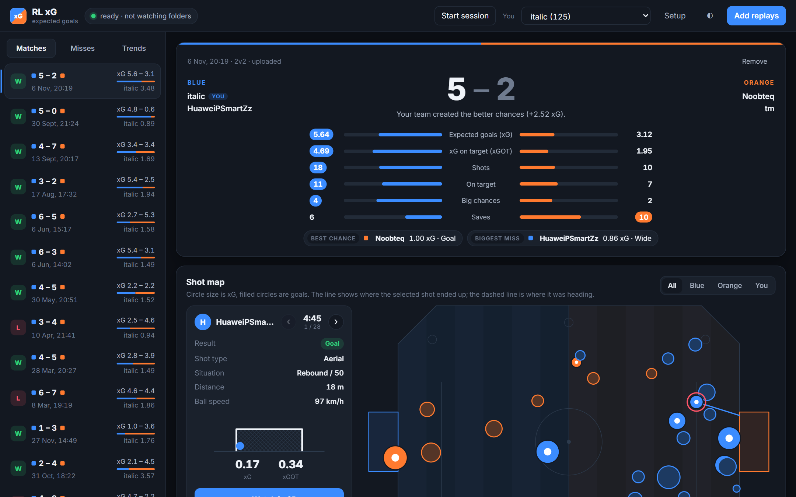

Every shot gets two numbers:

- **xG (chance quality):** how good the chance was *before* the touch, from where the ball, shooter and defenders were. An open net you miss is still a big chance.
- **xGOT (xG on target):** how likely the shot was to score *as struck*, from where the touch actually sent the ball. **xGOT − xG** shows how well a player strikes their chances.

The model is trained on about **387,000 shots from 16,000 ranked 2v2 games**. On games it never saw, its xGOT is within 2% of the real goal count, with an AUC of 0.94.

> This rebuilds [**sertalpbilal/rocket_league_analytics**](https://github.com/sertalpbilal/rocket_league_analytics), the original Rocket League xG project, on a modern replay parser. It adds physics-based shot detection, richer features and about 35× more data. See [Credits](#credits).

---

## Contents

- [Quick start](#quick-start)
- [How it works](#how-it-works): the pipeline, step by step
- [Data](#data) · [Performance](#performance)
- [Dashboard](#dashboard)
- [Rebuilding the model](#rebuilding-the-model)
- [Project layout](#project-layout) · [Credits](#credits)

## Quick start

```bash
git clone https://github.com/isaactallack/rl-xg.git
cd rl-xg
python -m venv .venv
.venv/Scripts/pip install -r requirements.txt      # macOS/Linux: .venv/bin/pip
```

The trained model (`models/xg_model.joblib`) is in the repo, so you can score replays straight away:

```bash
python -m rlxg path/to/game.replay --shots                      # team/player xG + every shot
python -m rlxg path/to/Demos/folder --json out.json --csv shots.csv
```

```python
from rlxg import analyze_replay

m = analyze_replay("game.replay")
m.teams, m.players, m.shots      # pandas DataFrames
m.to_dict()                      # JSON-ready
```

Or run the dashboard and open http://localhost:4200:

```bash
python -m rlxg.dashboard          # Windows: run_dashboard.bat
```

Rocket League saves replays to `Documents/My Games/Rocket League/TAGame/Demos`. The model covers **2v2** only.

---

## How it works

```mermaid
flowchart LR
    subgraph SRC["① Replays"]
        K["Kaggle high-level<br/>15k SSL games"]
        B["Ballchasing<br/>426 C3–GC2 games"]
        O["Original repo<br/>437 games (2021)"]
    end
    P["② Parse<br/>subtr-actor → per-frame<br/>ball + car physics"]
    T["③ Touches<br/>velocity jumps with a<br/>car hitbox in range"]
    S["④ Shots<br/>last touch of a carry,<br/>simulated path hits goal"]
    L["⑤ Label<br/>goal before own team<br/>touches again (7 s)"]
    F["⑥ Features<br/>~50 geometric features<br/>pre- and post-touch"]
    M["⑦ Models<br/>LightGBM xG + xGOT<br/>+ per-rank calibration"]
    D["⑧ Use<br/>CLI · Python API ·<br/>live dashboard"]
    SRC --> P --> T --> S --> L --> F --> M --> D
```

### ① Replays

A `.replay` file is a network recording of the match, not a video. Training uses three sources (see [Data](#data)): mostly high-level games, because physics is the same at every rank and there are many more of them, plus a smaller set of mid-rank games to set the conversion level.

### ② Parse: [`rlxg/parse.py`](rlxg/parse.py)

[subtr-actor](https://github.com/rlrml/subtr-actor) (Rust, built on boxcars) decodes the replay into per-frame arrays: ball position and velocity, each car's position, rotation, velocity and boost, plus goals and the end-of-game scoreboard. It replaces the original project's carball, which is no longer maintained.

### ③ Touches: [`rlxg/touches.py`](rlxg/touches.py)

Replays don't reliably record who touched the ball, so touches are rebuilt from physics. A **touch** is a jump in ball velocity that gravity can't explain (> 120 uu/s) while a car's **oriented hitbox** is in contact range. Impulses from the same player within 0.12 s merge into one touch.

### ④ Shots: [`rlxg/shots.py`](rlxg/shots.py) + [`rlxg/physics.py`](rlxg/physics.py)

Not every touch is a shot. A dribble is many touches, and a clearance isn't a shot at all. So:

1. **One candidate per carry.** Consecutive touches by the same player form a carry. Only the touch that *releases* the ball counts.
2. **Simulate the ball.** From the ball's state just after that touch, a small physics model plays the ball forward for 5 s, with gravity, drag and bounces off the floor and walls (with friction).
3. **Does it reach the goal?** If the simulated ball crosses the goal line inside the goal mouth plus a margin (500 uu wide, 250 uu over), it's a shot. The margin keeps near-misses as off-target shots instead of dropping them.

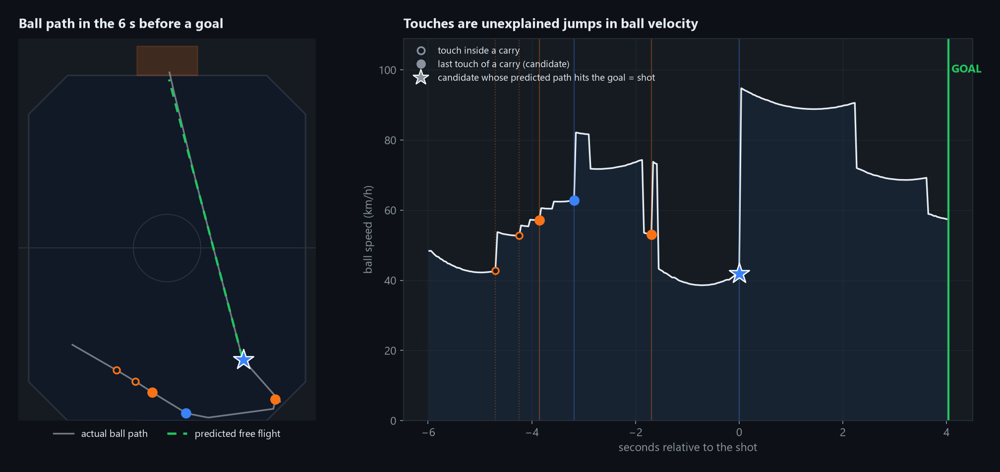

*Left: the ball in the six seconds before a goal. Hollow dots are touches inside a carry, filled dots end a carry, and the star is the touch whose simulated path (green, dashed) reaches the goal. Right: the same touches as jumps in ball speed.*

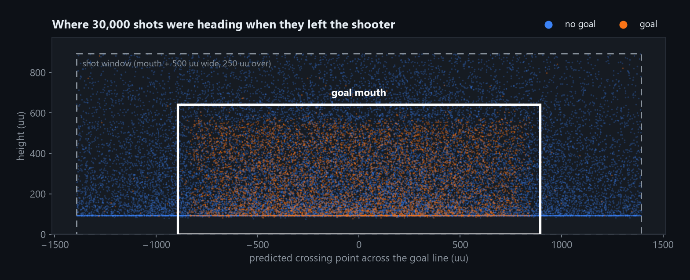

*Each dot is where a shot's simulated path crossed the goal line. Goals (orange) sit inside the mouth. The dashed box is the shot window. Shots along the bottom edge are ground shots, whose centre is one ball radius up.*

Shot selection **never looks at the outcome**, so goals can't leak into the shot set.

### ⑤ Label

A shot is a **goal** if the shooting team scores before any of its players touches the ball again, within 7 s. A defender's deflection or failed save still credits the shooter.

**Setups aren't shots.** If the shooter's team plays the ball again before it would have reached the goal (the shooter dribbling on, or a teammate following up), that touch was a pass or dribble, and the later touch is the shot. Without this rule, a slow roll that a teammate taps in counts as a *missed* shot followed by a goal.

### ⑥ Features: [`rlxg/shots.py`](rlxg/shots.py)

Everything is computed in the **attacking frame** (the target goal is always at +y, mirrored left/right), so the model doesn't depend on team colour or which side of the pitch the shot came from. There are about 50 features per shot, in two groups:

| Group | Before the touch (chance xG) | After the touch (xGOT) |
|---|---|---|
| Ball | position, height, velocity, distance and angle to goal | speed and direction just after contact, strength of the touch |
| Trajectory | — | predicted crossing point, margin inside the posts/bar, time to goal, bounces |
| Shooter | approach speed, facing goal/ball, boost, airborne, dodge, how long they've had the ball | same |
| Build-up | time since last touch; was it a pass, rebound or own carry | same |
| Defence | each defender's time to reach the straight ball→goal line, goal-side defenders, goalkeeper position and movement | each defender's **intercept margin** along the predicted path, how many can intercept |
| Support | teammate's distance to the ball and goal | same |

Location alone explains a lot, but not everything. Shots from the same spot can be open nets or blocked by two defenders:

<p align="center">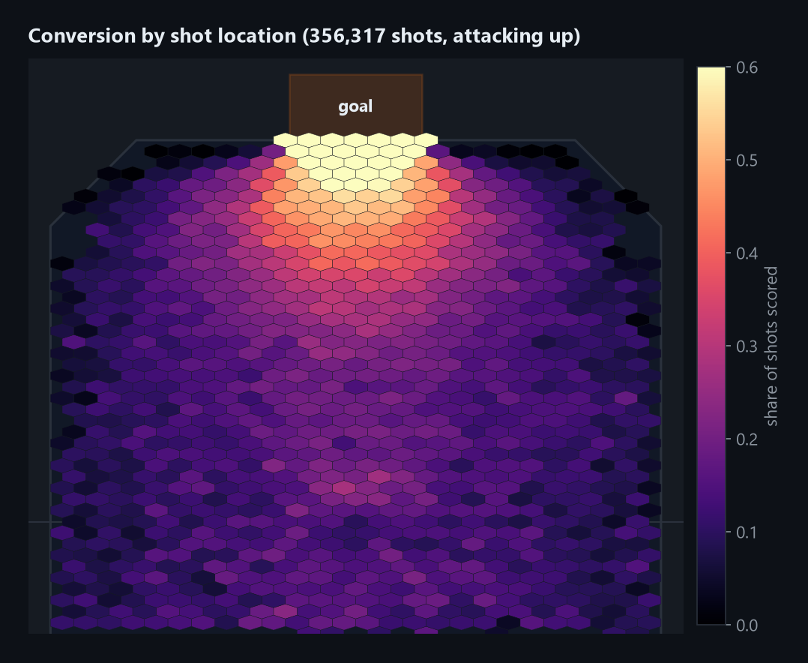</p>

### ⑦ Models: [`rlxg/model.py`](rlxg/model.py), [`scripts/train.py`](scripts/train.py)

Two **LightGBM** classifiers are trained on the same shots:

- **xG** only sees the situation the instant *before* the touch, like football xG.
- **xGOT** sees where the touch actually sent the ball.

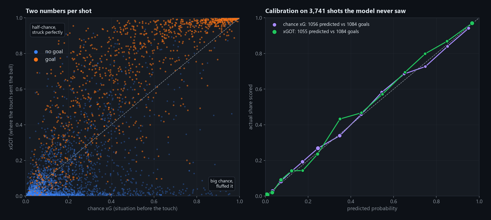

*Left: each shot from a holdout of the author's own games, which the model never trained on. Big chances that were fluffed sit bottom-right, and half-chances that were struck perfectly sit top-left. Right: predicted probability against how often shots actually went in. Both models sit on the diagonal.*

**Calibrating per rank.** Physics is the same at every rank, but defenders aren't: a model trained only on SSL games ranks mid-rank shots just as well, but under-predicts their goals by 14%. So each classifier is trained mainly on the high-level data, then given a **per-rank-band calibration**: a logistic correction on the logit, fitted on games from that band. The default band is **C3–GC2**, and `--skill ssl` is also available.

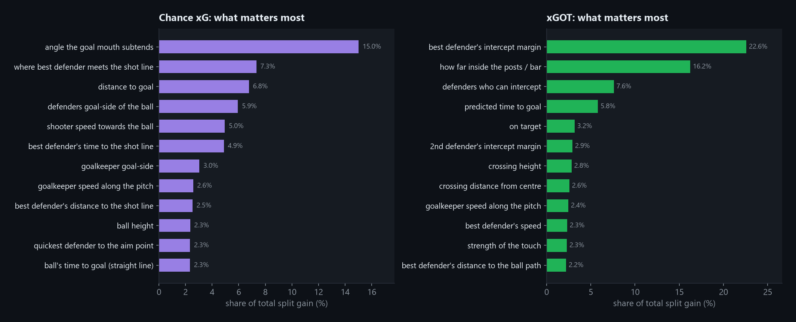

Chance xG depends mostly on geometry and where the defenders stand. xGOT depends mostly on whether a defender can get to the ball's actual path, and how close it is heading to the posts.

### ⑧ Where the shot ended: [`rlxg/outcome.py`](rlxg/outcome.py)

For the dashboard, the real ball is followed from the touch until the first of these:

- a goal
- a car touching it: an opponent stopping an on-target shot within 2,200 uu of goal is a *save*, otherwise a *block*
- the post or crossbar
- the back wall beside or above the goal (*wide* / *over*)
- a side wall, ramp or ceiling (*off the wall*)

The end point, the predicted path and a 3D clip of the play are stored with each shot.

---

## Data

The model covers 2v2 only and is trained on about 387k shots.

| Source | Games | Shots | Conversion | Used for |
|---|---|---|---|---|
| [High-Level RL Replay Dataset](https://www.kaggle.com/datasets/rolvarild/high-level-rocket-league-replay-dataset) (Kaggle), newest 15k ranked 2s, Mar 2025 – Apr 2026, mostly SSL lobbies | 14,997 | 366k | 23.7% | training (10% held out for SSL calibration) |
| [Ballchasing](https://ballchasing.com), newest ranked 2s where every player is C3–GC2 (Apr 2026, 184 uploaders) | 426 | 8.7k | 27.8% | C3–GC2 calibration |
| Replays from the [original repo](https://github.com/sertalpbilal/rocket_league_analytics) (2021) | 437 | 8.1k | 31.5% | training |
| The author's own games | 168 | 3.7k | 29.0% | holdout only |

The replays and the shot tables built from them are **not in this repo**; they come to tens of GB. The [rebuilding](#rebuilding-the-model) scripts download and rebuild them.

Checked against the game's own stats, about 95% of goals land on a detected shot. The rest are own goals or late deflections. Shot counts come out about 1.3× the game's "Shot" stat, because near-misses count as off-target shots.

## Performance

All numbers are out-of-sample.

| Games | Model | Predicted vs goals | Log loss | AUC |
|---|---|---|---|---|
| C3–GC2 (cross-validated) | **xGOT** | 2,433 vs 2,432 | **0.259** | **0.944** |
| C3–GC2 (cross-validated) | chance xG | 2,432 vs 2,432 | 0.392 | 0.863 |
| Author's games (never trained on) | **xGOT** | 906 vs 929 (−2%) | 0.259 | 0.946 |
| Author's games (never trained on) | chance xG | 915 vs 929 (−2%) | 0.405 | 0.856 |
| SSL holdout | xGOT, `--skill ssl` | 8,606 vs 8,606 | 0.232 | 0.949 |
| SSL holdout | chance xG, `--skill ssl` | 8,606 vs 8,606 | 0.336 | 0.886 |

For scale, on C3–GC2 shots, guessing the base rate for every shot scores 0.558 log loss, and a classic distance + angle model scores 0.485. Chance xG is *meant* to score worse than xGOT, because it can't see where the touch sent the ball.

### Compared with the original

| | Original | This project |
|---|---|---|
| Parser | carball (unmaintained) | subtr-actor (Rust) |
| What counts as a shot | every touch | last touch of a carry whose simulated path reaches the goal |
| Features | raw position, velocity and rotation of the shooter and two opponents; no ball | ~50 geometric features in the attacking frame, including the ball and its predicted path |
| Model | XGBoost | LightGBM ×2 (chance xG + xGOT), per-rank calibration |
| Data | ~400 games | ~16,000 games |

Labelling every touch let dribble touches inflate xG, since a five-touch dribble towards goal counted as five shots.

---

## Dashboard

```bash
python -m rlxg.dashboard                      # Windows: run_dashboard.bat → http://localhost:4200
```

For each game it shows the score with a side-by-side comparison (xG, xGOT, shots, on target, big chances, saves), a shot map, an xG race chart, and player and shot tables.

<table>
<tr>
<td width="50%">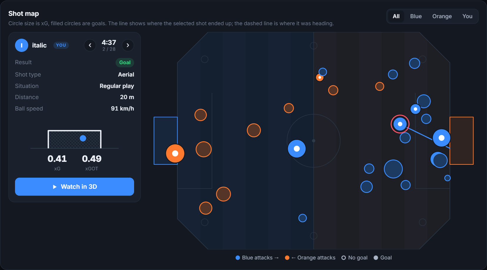<br><b>Shot map.</b> Circle area is xG, and filled circles are goals. Step through shots in the inspector to see where each one crossed the goal line.</td>
<td width="50%">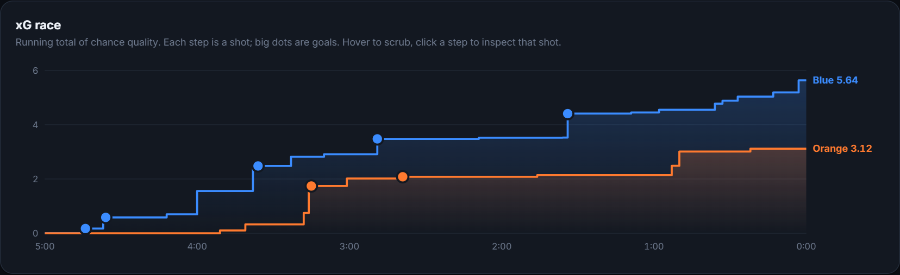<br><b>xG race.</b> A running total of chance quality for each team. Click a step to inspect that shot.</td>
</tr>
<tr>
<td>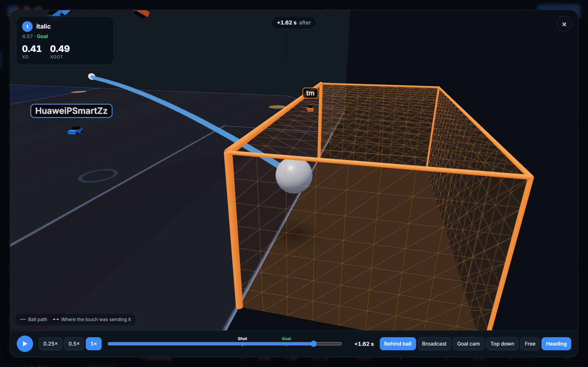<br><b>Watch in 3D.</b> The ball and all four cars from 3 s before the touch until the shot ends, with the ball's actual and predicted paths. Built with three.js.</td>
<td>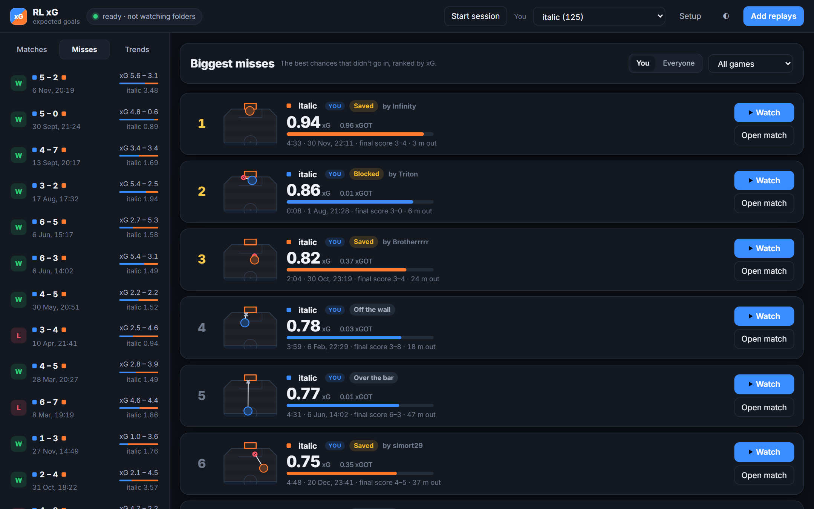<br><b>Misses.</b> The biggest chances that weren't scored, across all your games.</td>
</tr>
<tr>
<td colspan="2">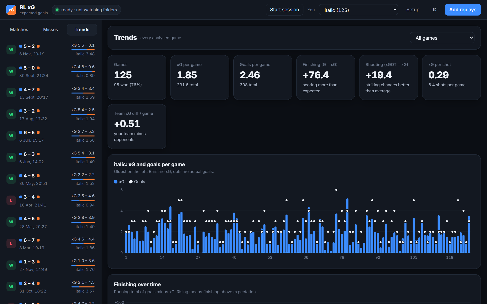<br><b>Trends.</b> Your xG, goals, finishing (goals − xG) and shooting (xGOT − xG) across games or within one session.</td>
</tr>
</table>

**Getting replays in** (everything is analysed in the background):

1. **Folder watching.** The Rocket League `Demos` folder is watched by default, and new replays are picked up when they're saved. `--backfill-hours 24` also picks up recent older ones, and `--watch "C:\path"` adds more folders.
2. **Drag and drop** `.replay` files onto the page, or use *Add replays*.
3. **[Rockpload](https://github.com/LEX0RE/rockpload)** (optional, Windows). It signs in to Epic and fetches replays from your match history, so games are captured even if Rocket League didn't save them. Download the Windows build into `tools/rockpload/` (see [tools/rockpload/README.md](tools/rockpload/README.md)). The dashboard then starts it and adds an upload target pointing at itself (Ranked Doubles only), leaving Rockpload's other settings untouched. Skip it with `--no-rockpload`.

**Sessions:** click *Start session* before you play, and every game until *End* is grouped together for the Trends tab.

**Model updates:** each game records which model version scored it. After you retrain, the next start re-scores stored games in the background.

History lives in `data/dashboard/xg.sqlite`. "You" is detected as the most frequent player, and can be changed in the header.

---

## Rebuilding the model

```bash
# 1a. high-level 2v2 replays from Kaggle (KAGGLE_API_TOKEN in .env). Reads only the needed
#     entries out of the 147 GB archive with HTTP range requests (~20 files/s)
python scripts/download_kaggle.py --mode 2v2 -n 0        # fetches metadata.jsonl only
python scripts/download_kaggle_archive.py --mode 2v2 -n 15000

# 1b. C3–GC2 games from ballchasing (BALLCHASING_TOKEN in .env). Rate limited, ~6/min
python scripts/download_ballchasing.py -n 1000

# 2. shots table. Each replay is parsed in its own subprocess and cached, so you can stop
#    and re-run to resume. Add --cached-only to train on what's parsed so far.
python scripts/build_dataset.py data/raw/hlrlrd_2v2 data/raw/ballchasing_c3_gc2 data/raw/legacy_2v2 "<your Demos folder>" -o data/shots.csv -j 6

# 3. train + evaluate (about 1 minute). Writes models/xg_model.joblib
python scripts/train.py data/shots.csv

python -m pytest tests
```

Copy `.env.example` to `.env` for the API tokens. The original repo's 2021 replays go in `data/raw/legacy_2v2`.

Other scripts:

- `scripts/validate_shots.py <replays...>` compares detected shots and goals with the in-game stats.
- `scripts/compare_sources.py` reruns the "how should SSL data be used for C3–GC2?" comparison.
- `docs/make_figures.py` regenerates the figures in this README.

## Project layout

```
rlxg/
  parse.py        replay → per-frame arrays (subtr-actor)
  touches.py      touch detection from ball impulses + car hitboxes
  physics.py      ball flight simulation (gravity, drag, bounces)
  shots.py        shot selection, labels, features
  model.py        XGModel: xG + xGOT boosters and per-band calibration
  outcome.py      where each shot ended + 3D clips
  analyze.py      analyze_replay(): the end-to-end entry point
  dashboard/      FastAPI server, SQLite store, file watcher, Rockpload glue, web UI
scripts/          downloading, dataset building, training, validation
models/           xg_model.joblib (the trained model)
docs/             README figures and the script that makes them
tests/            smoke tests
```

## Credits

- **[sertalpbilal/rocket_league_analytics](https://github.com/sertalpbilal/rocket_league_analytics)** by sertalpbilal: the original Rocket League xG model and the idea this builds on. Its 2021 replays are also part of the training data.
- **[subtr-actor](https://github.com/rlrml/subtr-actor)** and **[boxcars](https://github.com/nickbabcock/boxcars)**: replay parsing.
- **[High-Level Rocket League Replay Dataset](https://www.kaggle.com/datasets/rolvarild/high-level-rocket-league-replay-dataset)** on Kaggle: most of the training data.
- **[ballchasing.com](https://ballchasing.com)**: rank-tagged mid-level replays for calibration.
- **[Rockpload](https://github.com/LEX0RE/rockpload)**: replay fetching from Epic match history.
- **[LightGBM](https://github.com/microsoft/LightGBM)**, **[three.js](https://threejs.org)** (vendored r160) and **[FastAPI](https://fastapi.tiangolo.com)**.

Rocket League is a trademark of Psyonix. This project isn't affiliated with or endorsed by Psyonix or Epic Games.
